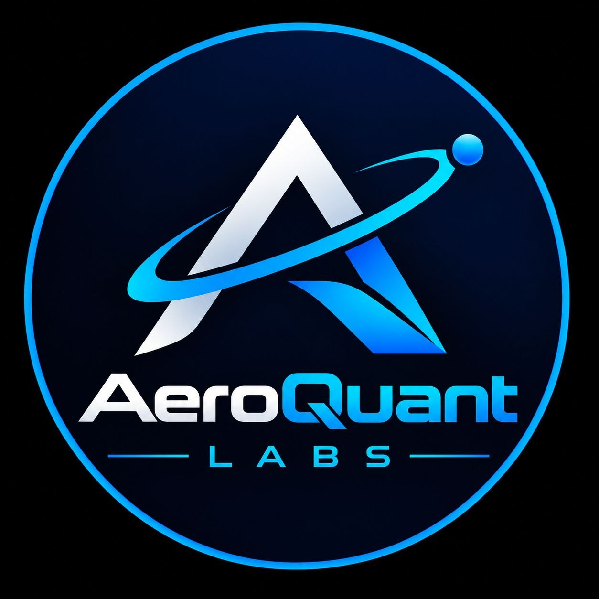
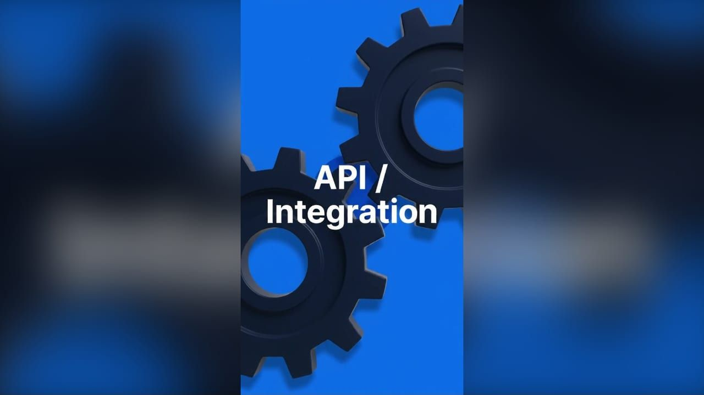

<div align="center">



# AeroQuant Labs

**Engineering solutions for All — Ready to Launch.**

A team of young software developers who build tools and products
that help solve problems in society.


[Live site](https://aeroquant-labs.vercel.app)
· [Email us](mailto:AeroQuantLabs55@gmail.com)
· [The team](#-the-team)

</div>

---

## 🧭 About

**AeroQuant Labs** is a software development team based in Accra, Ghana. We
design and ship web apps, internal tools, cloud infrastructure and automation
for people and organisations solving real problems.

This repository holds the **company website** — a single-page product tour
with a dedicated contact page, built to introduce the team and make it easy
to start a conversation.

<a href="aeroquant-labs/public/videos/aeroquant-commercial.mp4">
  
</a>

<p align="center"><em>Our 10-second commercial — click the frame to watch it.</em></p>

## ✨ What's on the site

| Section | What you'll find |
| --- | --- |
| **Hero & About** | Who we are and what we build |
| **Verticals** | The problems and industries we work in |
| **Ways to work with us** | Discovery Sprint · Product Build · Ongoing Partner |
| **Showreel** | The commercial in a landscape band, no player chrome |
| **FAQ & Blog** | Straight answers and engineering notes |
| **[Contact page](aeroquant-labs/src/app/contact)** | Accra map, contact methods and a *Let's Connect* form |

## 👥 The Team

Three co-founders, one standard: build things that are useful, accessible
and built to last.

| Maxwell Otsiwa Agyakwa | Bright Otsiwa Agyei | Elorm Kuami Loh |
| :---: | :---: | :---: |
| Co-founder | Co-founder | Co-founder |

## 🛠 Tech Stack

| Layer | Choice |
| --- | --- |
| Framework | [Next.js 15](https://nextjs.org/) (App Router) |
| Language | [TypeScript 5](https://www.typescriptlang.org/) |
| UI | React 19, [Tailwind CSS v4](https://tailwindcss.com/), Headless UI |
| Animation | AOS, Framer Motion |
| Theming | `next-themes` (light/dark) |
| Media | Native `<video>` band, OpenStreetMap embed |

## 🚀 Getting Started

Requires **Node.js 18.18+**.

```bash
git clone https://github.com/Maxorleans55/AeroQuant-Labs.git
cd AeroQuant-Labs/aeroquant-labs
npm install
npm run dev
```

Open [http://localhost:3000](http://localhost:3000).

| Command | Purpose |
| --- | --- |
| `npm run dev` | Start development server |
| `npm run build` | Production build |
| `npm run start` | Serve the production build |
| `npm run lint` | Run ESLint |

## 📁 Project Structure

```
AeroQuant-Labs/
├── aeroquant-labs/           # The Next.js application
│   ├── public/               # Static assets — logo, images, commercial video
│   └── src/
│       ├── app/
│       │   ├── page.tsx      # Home — the single-page product tour
│       │   ├── contact/      # Contact page
│       │   ├── api/          # Route handlers (all site content)
│       │   ├── components/   # React components
│       │   └── types/        # TypeScript types
│       └── utils/            # Helpers (AOS setup)
└── README.md
```

Application code lives in `aeroquant-labs/` so additional projects can be
added alongside it later.

## 📬 Contact

- ✉️ **Email** — [AeroQuantLabs55@gmail.com](mailto:AeroQuantLabs55@gmail.com)
- 📍 **Location** — Accra, Ghana · remote-first, meetings by appointment
- ⏱ **Response** — we reply to every message within two business days

## 🙏 Attribution

Scaffolded from the free
[Desgy Next.js landing page template](https://github.com/GetNextjsTemplates/desgy-nextjs-tailwind-landing-page-template-free)
by GetNextjsTemplates, built with React, Tailwind CSS and Headless UI.

The template ships **without a license file**, so its original code remains the
property of its authors. It is used here as a non-commercial starting point.
All modifications and original work in this repository are © AeroQuant Labs.

## 📄 License

UNLICENSED — private, all rights reserved.
