<div align="center">



# AeroQuant Labs

**Engineering solutions for All — Ready to Launch.**

A team of young software developers who build tools and products
that help solve problems in society.


[Live site](https://aeroquant-labs.vercel.app)
· [Email us](mailto:AeroQuantLabs55@gmail.com)
· [The team](#-the-team)

</div>

---

## 🧭 About

**AeroQuant Labs** is a software development team based in Accra, Ghana. We
design and ship web apps, internal tools, cloud infrastructure and automation
for people and organisations solving real problems.

This repository holds the **company website** — a product tour with
dedicated tools, contact, privacy and terms pages, built to introduce
the team and make it easy to start a conversation.

## ✨ What's on the site

| Section | What you'll find |
| --- | --- |
| **Hero & About** | Who we are and what we build |
| **Team** | Seven members — photos or styled initials, LinkedIn badges, a hand-scrollable carousel |
| **Verticals** | The problems and industries we work in |
| **Ways to work with us** | Discovery Sprint · Product Build · Ongoing Partner |
| **Showreel** | The commercial in a landscape band, no player chrome |
| **FAQ & Blog** | Straight answers and engineering notes |
| **[Tools](aeroquant-labs/src/app/tools/page.tsx)** | What we're building — tools listed here as they ship |
| **[Contact page](aeroquant-labs/src/app/contact)** | Accra map, contact methods and a *Let's Connect* form |

## 👥 The Team

Seven members, one standard: build things that are useful, accessible
and built to last.

| Name | Role | LinkedIn |
| --- | --- | --- |
| Maxwell Otsiwa Agyakwa | Frontend Developer & Digital Forensics | [Profile](https://www.linkedin.com/in/maxwell-agyakwa-otsiwa-01643a3b2) |
| Bright Otsiwa Agyei | Co-founder | — |
| Elorm Kuami Loh | Frontend Developer | [Profile](https://www.linkedin.com/in/elormloh) |
| Solomon Agyabeng Jr | Frontend Developer | — |
| Benedicta Stoff Boadi | UI/UX Designer & Backend Developer | — |
| Joel Annorh | Full Stack Developer | [Profile](https://www.linkedin.com/in/joel-annorh-7b441a357) |
| Nana Obeng |  | — |

## 🛠 Tech Stack

| Layer | Choice |
| --- | --- |
| Framework | [Next.js 15](https://nextjs.org/) (App Router) |
| Language | [TypeScript 5](https://www.typescriptlang.org/) |
| UI | React 19, [Tailwind CSS v4](https://tailwindcss.com/), Headless UI |
| Animation | AOS, Framer Motion |
| Theming | `next-themes` (light/dark) |
| Media | Native `<video>` band, OpenStreetMap embed |

## 🚀 Getting Started

Requires **Node.js 18.18+**.

```bash
git clone https://github.com/AeroQuant-Labs/AeroQuant-Labs.git
cd AeroQuant-Labs/aeroquant-labs
npm install
npm run dev
```

Open [http://localhost:3000](http://localhost:3000).

| Command | Purpose |
| --- | --- |
| `npm run dev` | Start development server |
| `npm run build` | Production build |
| `npm run start` | Serve the production build |
| `npm run lint` | Run ESLint |
| `npm test` | Run the Playwright E2E suite |
| `npm run test:report` | Open the HTML report from the last run |

## 🧪 Testing

End-to-end tests drive the real site in Chromium — forms, links, videos,
animations and APIs are exercised exactly as a visitor would use them:

```bash
npm test            # runs the suite (reuses a dev server on :3000, or starts one)
npm run test:report # open the HTML report from the last run
```

The suite covers the contact and Join us forms (validation → mailto
handoff → confirmation), nav anchors, the FAQ accordion, the one-shot hero
assembly (paints, then must go static), both commercial videos, the live
news feed, the privacy, terms and tools pages, the branded 404, footer
cross-navigation, API payloads (including the curated footer), and a clean
console/network pass. GitHub Actions runs the same suite on every push and
pull request to `main` (`.github/workflows/e2e.yml`), and every push to
`main` also deploys the production site on Vercel.

## 📁 Project Structure

```
AeroQuant-Labs/
├── .github/workflows/       # CI — Playwright E2E on every push/PR
├── aeroquant-labs/           # The Next.js application
│   ├── public/               # Static assets — logo, images, commercial video
│   ├── tests/e2e/            # Playwright end-to-end tests
│   └── src/
│       ├── app/
│       │   ├── page.tsx      # Home — the product tour
│       │   ├── contact/      # Contact page
│       │   ├── privacy/      # Privacy policy page
│       │   ├── terms/        # Terms & conditions page
│       │   ├── tools/        # Tools page
│       │   ├── api/          # Route handlers (all site content)
│       │   ├── components/   # React components
│       │   └── types/        # TypeScript types
│       └── utils/            # Helpers (AOS setup)
└── README.md
```

Application code lives in `aeroquant-labs/` so additional projects can be
added alongside it later.

## 📬 Contact

- ✉️ **Email** — [AeroQuantLabs55@gmail.com](mailto:AeroQuantLabs55@gmail.com)
- 💬 **WhatsApp channel** — [AeroQuant Labs on WhatsApp](https://whatsapp.com/channel/0029VbEEybm9Gv7VzgvwOg0Y)
- 📍 **Location** — Accra, Ghana · remote-first, meetings by appointment
- ⏱ **Response** — we reply to every message within two business days

## 🙏 Attribution

Scaffolded from the free
[Desgy Next.js landing page template](https://github.com/GetNextjsTemplates/desgy-nextjs-tailwind-landing-page-template-free)
by GetNextjsTemplates, built with React, Tailwind CSS and Headless UI.

The template ships **without a license file**, so its original code remains the
property of its authors. It is used here as a non-commercial starting point.
All modifications and original work in this repository are © AeroQuant Labs.

## 📄 License

UNLICENSED — private, all rights reserved.
